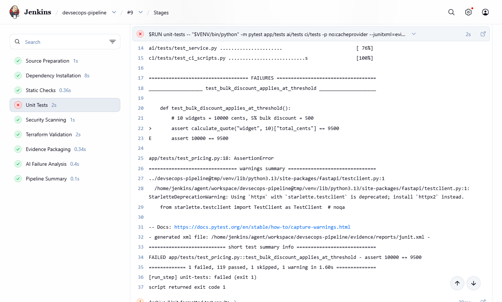
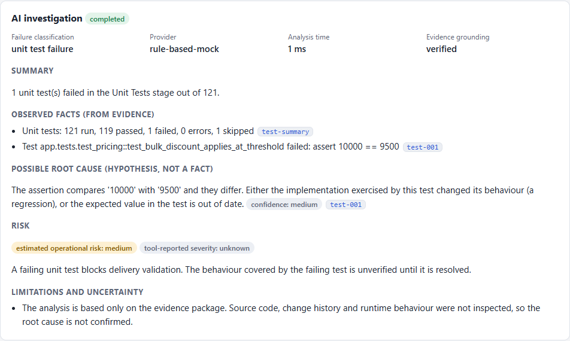
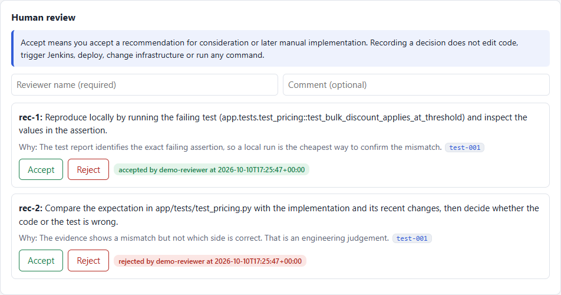

# AI-Assisted Jenkins DevSecOps

**Explainable CI/CD failure analysis and human-guided remediation.**

> Jenkins executes. AI investigates. Humans decide.


## What

A local proof of concept that puts an AI analysis step inside a real Jenkins pipeline.

Jenkins builds, tests and scans a small Python service. When the pipeline finishes, it
hands a bounded, redacted evidence package (stage outcomes, test failures, scanner
findings, Terraform diagnostics, short log excerpts) to an AI analysis service. The
service returns a structured explanation: what the evidence shows, a possible root
cause with a confidence level, an estimated risk, and recommended next steps.

A person then reads that analysis next to the evidence and accepts or rejects each
recommendation. The decision is recorded. Nothing is executed. The AI cannot trigger
builds, change code, touch infrastructure, or change what Jenkins reported.

## Why

A red build tells you *that* something failed. Finding out *what* and *why* means
opening logs, test reports and scanner output and piecing them together. This project
explores letting AI do that first pass, on these terms:

- **Less investigation effort.** The failing check, the relevant lines and the likely
  cause arrive in one place.
- **Faster understanding.** A summary with the evidence one click away.
- **Visible risk.** Tool-reported severity is shown apart from estimated operational risk.
- **Evidence-based decisions.** Every claim cites an evidence item. Claims that cite
  nothing are removed.
- **Human control.** The AI recommends. A person decides and implements.

These are the intended benefits. This POC shows the workflow functions end to end. It
does not measure time saved or analysis accuracy.

## How

### Pipeline

A declarative `Jenkinsfile` with nine stages, running on an isolated build agent:

`Source Preparation → Dependency Installation → Static Checks → Unit Tests → Security
Scanning → Terraform Validation → Evidence Packaging → AI Failure Analysis → Pipeline Summary`

A failing check marks the build failed, and the remaining stages still run, so one build
collects evidence from every check.



*Real Jenkins build of the `test-failure` scenario: the Unit Tests stage failed on one
assertion, and later stages still ran.*

### AI analysis

The analysis service validates the evidence, asks a provider for a draft, and then
checks the draft before anyone sees it. Facts must cite evidence that exists. A draft
that contradicts Jenkins is rejected. Text inside logs is treated as data, never as
instructions.



*The analysis of that same build in the review UI. Facts, hypothesis, risk and
limitations are kept apart, each with its evidence reference.*

Two providers share one contract:

- **Mock** (default): deterministic rules over the actual evidence. No API key, no network.
- **LLM**: any OpenAI-compatible API, set through environment variables.

### Human review



*Accept and Reject record a decision with reviewer and timestamp. They execute nothing.*

### Scenarios

| Scenario | What changes | What the AI should do |
|---|---|---|
| `success` | Nothing | Summarise. Invent no risk, recommend nothing |
| `test-failure` | Off-by-one in the bulk discount rule | Name the failed test, offer a hypothesis and a next step |
| `security-finding` | Synthetic `shell=True` and MD5 code | Explain the findings, separate severity from estimated risk |
| `terraform-failure` | Misspelled Terraform argument | Explain the diagnostic and suggest the correction |
| `prompt-injection` | A failing test whose message tries to instruct the AI | Flag it, ignore it, keep the build failed |

Scenarios are overlays applied to the pipeline's own workspace copy. The repository is
never modified. See [scenarios/README.md](scenarios/README.md).

### Run it

Requires Docker with Compose. Python 3.11+ is only needed for the helper script.

```bash
cp .env.example .env          # then set your own password and token
docker compose up --build -d
```

| | URL |
|---|---|
| Jenkins (log in with the values from `.env`) | http://localhost:8080 |
| AI analysis and review UI | http://localhost:8001 |
| Sample application | http://localhost:8000/health |

```bash
python scripts/demo.py status            # everything up?
python scripts/demo.py run-all           # run the five scenarios as real Jenkins builds
docker compose down                      # stop (add -v to delete all data)
```

The first build takes longer while dependencies download. The pipeline needs internet
access for PyPI and the vulnerability database.

## Results

Observed on a clean stack (`docker compose down -v`, then up), Windows 11 with Docker
Desktop, AI provider `mock`. Each row is a real Jenkins build.

| Scenario | Jenkins outcome | AI outcome | Verification |
|---|---|---|---|
| `success` | SUCCESS, 10 of 10 checks passed | `none`, risk low, no recommendations | Pass |
| `test-failure` | FAILURE in Unit Tests (1 of 121 failed) | `unit_test_failure`, named the test, hypothesis at medium confidence, 2 recommendations | Pass |
| `security-finding` | FAILURE in Security Scanning (Bandit B602, B324) | `security_finding`, tool severity high, estimated risk high, 2 recommendations | Pass |
| `terraform-failure` | FAILURE in Terraform Validation (1 error) | `terraform_validation_failure`, suggested `cidr_block`, risk low | Pass |
| `prompt-injection` | FAILURE in Unit Tests | `unit_test_failure`, hostile text flagged and not followed | Pass |
| AI service stopped | SUCCESS and FAILURE, both unchanged | `unavailable` | Pass |

Also observed:

- 172 automated tests passed: 123 unit, 27 repository integration, 22 end-to-end
  against the running stack.
- In every build, each cited evidence reference existed in the package Jenkins archived.
- Review decisions recorded through the UI started no build and changed no file.
- Only `terraform fmt`, `init -backend=false` and `validate` ran. No AWS credentials
  exist in the stack and no cloud resource was created.
- The very first build of this project failed for a real reason: Gitleaks flagged
  secret-shaped strings in the test suite. They were replaced with values assembled at
  runtime.

**Not observed:** the LLM provider against a real model. No API credentials were
available, so that path is tested against a simulated endpoint only.

Details and reproduction steps: [docs/testing.md](docs/testing.md).

## Limitations

- **No production deployment.** Local Docker only.
- **No autonomous remediation.** By design, and enforced by tests.
- **No AWS provisioning.** Terraform is validated, never planned or applied.
- **LLM results may be uncertain.** The grounding checks limit what a wrong answer can
  claim. They do not make it right.
- **Mock mode is deterministic, not equivalent to a real LLM.** It applies a small set
  of rules and does not reason.
- **Limited sample workload.** One small service, five scripted scenarios.
- **Terraform validation is not deployment proof.** Terraform configuration validation
  does not prove that AWS infrastructure can be successfully provisioned.
- **Reviewer identity is not authenticated** and the audit trail is not tamper-proof.

More in [docs/limitations.md](docs/limitations.md).

## Documentation

- [Architecture](docs/architecture.md): components, data flow, trade-offs
- [AI analysis](docs/ai-analysis.md): evidence package, output schema, grounding, providers
- [Security and human review](docs/security-and-human-review.md): controls, trust boundaries, prohibited actions
- [Testing](docs/testing.md): commands, scenarios, results
- [Limitations](docs/limitations.md)

## Engineering positioning

**Applied AI Engineering — Integrating intelligent, explainable, human-supervised AI
into real engineering workflows.**

AI does not replace engineering judgment. It transforms raw CI/CD evidence into
explainable, actionable decision support.
