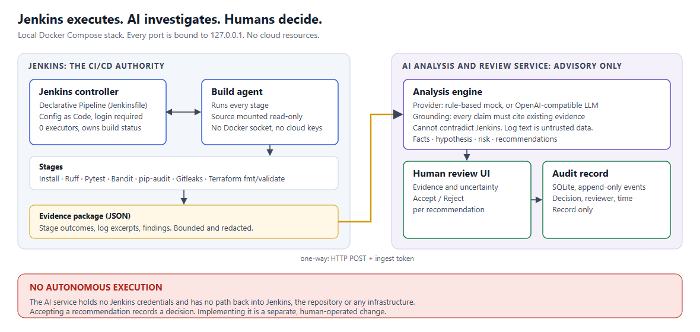

# Architecture

## Components

| Container | Role | Reachable at |
|---|---|---|
| `jenkins` | Jenkins LTS controller. Owns the pipeline definition, build status, test reports and artifacts. Runs no builds itself (0 executors). | http://localhost:8080 |
| `agent` | Inbound Jenkins agent. The only place pipeline workloads run. Carries Python, Terraform and Gitleaks. | not published |
| `ai` | AI analysis engine, review UI and SQLite audit store (one FastAPI process). | http://localhost:8001 |
| `app` | The sample quote service the pipeline builds and tests. | http://localhost:8000 |

A fifth image, `tests`, exists only to run the unit tests in a container
(`docker compose --profile tools run --rm tests`). It is not part of the running stack.

## Data flow

1. A person starts a build of `devsecops-pipeline` in Jenkins and picks a scenario.
2. **Source Preparation** copies the read-only source mount into the workspace and
   applies the scenario overlay, if any.
3. The check stages run. Each check goes through `ci/run_step.py`, which passes the
   exit code through to Jenkins and records the outcome and log.
4. **Evidence Packaging** (`ci/package_evidence.py`) builds `evidence.json`: stage
   outcomes, structured findings and short log excerpts of failed checks. It is size
   bounded and redacted, then archived as a build artifact.
5. **AI Failure Analysis** (`ci/submit_evidence.py`) POSTs that file to the AI service
   and archives the answer as `ai-analysis.json`.
6. A person opens the review UI, reads the analysis next to the evidence, and records
   Accept or Reject per recommendation. That writes an audit event and nothing else.

## Jenkins integration

- **Configuration as Code** (`jenkins/configuration/jenkins.yaml`) defines the admin
  user, authorization, the agent node and the ingest-token credential. Two small init
  scripts create the Pipeline job from the repository's `Jenkinsfile` and publish the
  agent's connection secret to a volume shared only with the agent container.
- **Failure handling.** Each check is wrapped in `catchError(buildResult: 'FAILURE')`.
  The build is marked failed immediately, but later stages still run, so one build
  yields evidence from every check.
- **Result authority.** Jenkins results can only get worse during a build, never
  better. The AI stage runs after the result is established, always exits 0, and has no
  step that sets the result. The Jenkinsfile contains no `retry`, no downstream build
  trigger and no deployment step. `tests/test_repository.py` enforces this.

## AI boundaries

The integration is a one-way push from Jenkins to the AI service.

- The AI service has no Jenkins URL, no Jenkins credentials and no code that can start
  a process. It makes one kind of outbound request: the LLM call, in `llm` mode only.
- It receives the evidence package and nothing else. No workspace, no full logs.
- Its HTTP surface is nine routes, none of which executes anything. The complete list
  is pinned in `ai/tests/test_boundaries.py`.

## Trade-offs

| Decision | Why | Cost |
|---|---|---|
| Source reaches the agent as read-only bind mounts instead of a Git checkout | Works on uncommitted local changes, and `.env` and `.git` stay invisible to builds | Not how a shared Jenkins would get source. The job reads the `Jenkinsfile` at controller start, so edits need `docker compose restart jenkins`. |
| Static inbound agent instead of per-build containers | No Docker socket or Docker-in-Docker anywhere | Builds share one long-lived agent. Isolation between builds is workspace cleanup only. |
| Scenario overlays instead of branches | Reproducible without commits, nothing to reset | The pipeline has a demo-only parameter a production pipeline would not. |
| `catchError` on every check | Complete evidence from a single build | A broken build spends time on later stages. |
| Evidence pushed by the pipeline instead of pulled by the AI | The AI needs no Jenkins access at all | Analysis only happens when the pipeline reaches that stage. A build that crashes earlier gets none. |
| One process for analysis, UI and audit store | Fewer moving parts | Not independently scalable. |
| Logged-in users can do anything in Jenkins | One local admin is enough here | No role separation inside Jenkins. |
